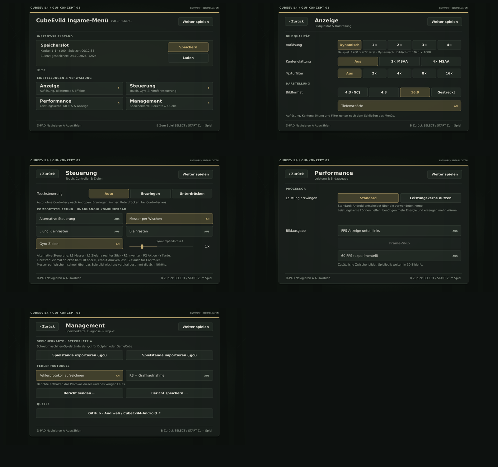

# Ingame-Menü: Erstanalyse und Screendesign

Stand: 24.10.2026. Grundlage: `beta-optimisations`, Commit
[`19bd01c`](https://github.com/Andiweli/CubeEvil4-Android/commit/19bd01c4aca8a2fecc287ea0cb7c484a0f9af5ad).
Arbeitsbranch: **`gui-optimisations`**, von genau diesem Commit abgezweigt.

Die ursprüngliche Erstanalyse steht nachfolgend als Referenz. Das abgestimmte
Menü und Instant-Speichern/Laden sind inzwischen implementiert: siehe
[Umsetzung, Prüfungen und lokale Bauanleitung](IMPLEMENTATION.md). Die Bilder
enthalten die anschließend gewünschten Titel- und Slot-Änderungen.

Zusätzlich geprüft: [Frame Skip unter Performance – Machbarkeit und Grenzen](FRAME-SKIP.md).
Die Funktion ist noch nicht implementiert; im Menü steht ein deaktivierter Platzhalter.

Aktueller Menüstand: 10 % Transparenz, größere fette Navigationstitel mit
kleineren normalen Unterzeilen, größere Infotexte und kompakter Speicherslot
mit Informationen links und Aktionen rechts. Die App passt die Spalten an
Fensterbreite, Textlänge und Systemschrift an; die SVG-Entwürfe zeigen eine
breite Beispielansicht.
Instant-Laden ist außerdem direkt im ruhenden Startmenü freigegeben. Speichern
bleibt auf eine laufende, steuerbare Spielsituation beschränkt.

## Die fünf Entwürfe



| Seite | Screendesign | Inhalt |
|---|---|---|
| Hauptseite | [01-hauptseite.svg](01-hauptseite.svg) | Instant-Speichern/Laden oben, darunter vier Untermenüs |
| Anzeige | [02-display.svg](02-display.svg) | Auflösung, Kantenglättung, Texturfilter, Bildformat, Tiefenschärfe |
| Steuerung | [03-controls.svg](03-controls.svg) | Touch-Modus, alternative Steuerung, Gyro, Wischmesser, Einrasten |
| Performance | [04-performance.svg](04-performance.svg) | Leistungskerne, experimentelle 60 FPS, FPS-Anzeige |
| Management | [05-management.svg](05-management.svg) | Speicherkarten-Import/Export, Fehlerbericht, R3-Aufnahme, Projektlink |

[Klickbarer Entwurf: index.html](index.html) — die Datei herunterladen und lokal
im Browser öffnen. Keine Installation, keine externen Ressourcen. Navigation,
Auswahlbuttons, Gyro-Regler sowie simulierte Save/Load-Bestätigungen sind enthalten.
Die Schaltflächen unter der Vorschau zeigen einen leeren oder gesperrten
Instant-Speicherplatz. Es werden keine echten Spielstände gelesen oder geschrieben.
Die Pfeiltasten simulieren eine einfache Fokusreihenfolge, Enter aktiviert,
Escape geht zurück. Ein Android-Controller ist damit noch nicht getestet.

[Alle fünf Screendesigns als PDF](CubeEvil4-Screendesigns.pdf).

**Gestaltungsvorschlag:** Anthrazit mit leichter Olivtönung, warme helle Schrift,
gedecktes Gold für Auswahl und Hauptaktion. Button-Ecken etwa 6 dp, Fenster etwa
10 dp. Der Hintergrund ist eine abstrakte Platzhaltergrafik; in der App bleibt das
pausierte Spiel hinter der Abdunklung sichtbar. Alle Spielstandwerte und gewählten
Einstellungen in den Bildern sind Beispiele, keine vom Gerät gelesenen Werte.

Die vier Untermenünamen entsprechen Deiner Vorgabe. Die übrigen Texte sind hier
Deutsch; die tatsächliche App soll weiterhin der Handy-Sprache folgen und sonst
Englisch verwenden. Bestehend sind Englisch und zehn Übersetzungen.

## 1. Bestehendes Menü

Das relevante Menü ist **`CoreMenu.java`** in
`port/android-decomp/app/src/main/java/com/ast/re4decomp/`. `ControllerActivity`
und `GameSaveStore` gehören zur älteren, eigenen Spielruntime und sind nicht die
Grundlage für die aktuelle Kern-App.

- `CoreActivity.select()` öffnet das App-Menü beim Loslassen von SELECT vor einer
  Sekunde. Langes Halten fordert das Debug-Menü des Spiels an.
- `openMenu()` gibt Eingaben frei, fordert mit `CoreBridge.pause(true, 800)` eine
  Pause an und stoppt Ton und Vibration. Das Menü wird **auch dann angezeigt, wenn
  der Kern innerhalb dieser Frist noch nicht angehalten hat**. Save/Load darf sich
  deshalb nicht allein auf ein sichtbares Menü verlassen.
- `CoreMenu` baut derzeit einen langen `ScrollView` mit sechs Bereichen:
  Grafik, Steuerung, Speicherkarte, Fehlerprotokoll und Quelle; die CPU-Auswahl
  steht innerhalb des Grafikbereichs. Es gibt kein eigenes Instant-Save/Load.
- Grafik-, Touch- und CPU-Auswahl benutzen `RadioGroup`/`RadioButton`.
  Unabhängige Schalter benutzen `CheckBox`. Die Gyro-Empfindlichkeit ist ein
  `SeekBar` und bleibt ein Regler.
- B, START und SELECT schließen momentan das gesamte Menü. Für die neue
  Hierarchie soll B beziehungsweise Android-Zurück zunächst zur Hauptseite führen.
- Texte stehen in `res/values*/strings_ingame.xml`, gespeicherte Einstellungen in
  den vorhandenen Grafik- und Eingabe-Präferenzen. Ihre Schlüssel und Werte
  sollten erhalten bleiben, damit ein Update nichts zurücksetzt.

### Vollständige Zuordnung der vorhandenen Funktionen

| Funktion im aktuellen `CoreMenu.build()` | Neue Seite | Bedienung |
|---|---|---|
| Auflösung: Dynamisch, 1×, 2×, 3×, 4× | Anzeige | Genau ein aktiver Button |
| Kantenglättung: Aus, 2× MSAA, 4× MSAA | Anzeige | Genau ein aktiver Button; Geräteunterstützung beachten |
| Texturfilter: Aus, 2×, 4×, 8×, 16× | Anzeige | Genau ein aktiver Button; Geräteunterstützung beachten |
| Bildformat: 4:3 (GC), 4:3, 16:9, Gestreckt | Anzeige | Genau ein aktiver Button |
| Tiefenschärfe | Anzeige | Unabhängiger AN/AUS-Button |
| Auflösungsinformation inkl. Bildschirmgröße | Anzeige | Aktualisierte Statuszeile |
| Touchsteuerung: Auto, Erzwingen, Unterdrücken | Steuerung | Genau ein aktiver Button |
| Alternative Steuerung | Steuerung | Unabhängiger AN/AUS-Button |
| Gyro-Zielen | Steuerung | Unabhängiger AN/AUS-Button; ohne Sensor gesperrt mit Begründung |
| Gyro-Empfindlichkeit | Steuerung | Regler, 0,5× bis 3× in 0,25×-Schritten; nur bei aktivem Gyro |
| Messer per Wischen | Steuerung | Unabhängiger AN/AUS-Button |
| L und R einrasten | Steuerung | Unabhängiger AN/AUS-Button |
| B einrasten | Steuerung | Unabhängiger AN/AUS-Button |
| Hinweise zu Touch, alternativer Steuerung, Wischen und Einrasten | Steuerung | Kurze Erklärungen; auf kleinen Geräten scrollbar |
| Leistung erzwingen: Standard / Leistungskerne nutzen | Performance | Genau ein aktiver Button; Wärme-/Energiehinweis erhalten |
| 60 FPS (experimentell) | Performance | Unabhängiger AN/AUS-Button; Spiellogik bleibt 30 Hz |
| FPS-Anzeige unten links | Performance | Unabhängiger AN/AUS-Button |
| Alle Speicherkartendateien als .gci exportieren | Management | Aktionsbutton; bestehende Prüfungen erhalten |
| .gci importieren inkl. Ersetzen/Überspringen | Management | Aktionsbutton; bestehende Rückfragen erhalten |
| Fehlerprotokoll aufzeichnen | Management | Unabhängiger AN/AUS-Button |
| R3 = Grafikaufnahme | Management | Unabhängiger AN/AUS-Button |
| Bericht senden / Bericht speichern | Management | Zwei Aktionsbuttons |
| Projektquelle im Browser öffnen | Management | Aktionsbutton |
| App-Version / SELECT-Hinweis / Zurück zum Spiel | Gemeinsamer Rahmen | Version dynamisch, Hinweis kompakt, Weiterspielen jederzeit |
| Neu: Instant-Speichern / Instant-Laden | Hauptseite | Zwei Aktionsbuttons mit Status und Bestätigungen |

## 2. Save/Load: tatsächliche Schreibmaschinen-Logik

Der Originalpfad lautet `CardSave()` → Kartentask → `cCard::saveMain()` →
`cCard::makeSaveData()` in `src/game/card.cpp`. Die 20 Kartenplätze heißen
`bh4_data00` bis `bh4_data19`; Systemdaten stehen in `bh4_system`.
Ein regulärer Spielstand belegt acht Kartenblöcke, also 64 KiB.

`makeSaveData()` erledigt mehr als das Schreiben einer Datei:

1. Datum und Metadaten erstellen, Speicherzähler erhöhen und Spielzeit aktualisieren.
2. `GameSave.save()` ruft die Original-Speicherroutinen für alle Nutzdaten auf.
3. Globalen Spielzustand, Gegenstände, Raumdaten, Untermenü und Händlerdaten
   in den Dateipuffer kopieren.
4. Versionskennung und Prüfsummen für Kopf und Gesamtdatei schreiben.
5. Der Kartenablauf schreibt zusätzlich die Systemdatei mit den Spieloptionen.

`cGameSave::save()` in `src/game/game.cpp:858` übernimmt während des Spiels
(`Rno0 == 3`) ausdrücklich **`pPL->pos` und `pPL->ang.y`** in den gespeicherten
globalen Zustand. Die aktuelle Position und Blickrichtung sind also bereits Teil
der vorhandenen Logik. Dieselbe Methode ruft `RoomData.save`, `SscrnDataSave`,
`MerchantDataSave` und `ItemMgr.save` auf. Der globale Block enthält unter anderem
Fortschritt, Lebenspunkte, Geld und Zähler; Inventardaten liegen zusätzlich in
einem eigenen Block.

`cCard::loadMain()` prüft die Datei, kopiert dieselben fünf Bereiche zurück und
ruft `GameSave.load()` auf. Anschließend wird der Spiel-/Raumaufbau fortgesetzt.
`GameLoad()` und `GameContinue()` zeigen den bereits vorhandenen Weg für das
Laden eines gespeicherten Raums und seiner Spielerposition. Ein neuer Loader
muss diesen Lebenszyklus gezielt anstoßen; nur globale Werte zu überschreiben
würde die noch lebenden Raumobjekte nicht passend neu aufbauen.

**Grenze der Originalspeicherung:** Das ist ein Spielstand mit den Daten der
Schreibmaschine. Der Code speichert keine vollständige Kopie aller gerade
laufenden Gegnerobjekte, Geschosse, Animationen und Skript-Stacks. `RoomData.save`
kopiert die persistenten Raumdatensätze. Welche kurzfristigen Zustände beim
Speichern mitten in einem Raum schon darin angekommen sind, muss beim Bau und
im Spiel geprüft werden. Die exakte Spielerposition ist belegt; ein beliebiger
Animationsmoment einschließlich aller Gegnerzustände ist dadurch nicht belegt.

### Vorschlag für einen getrennten Instant-Spielstand

- **Ein eigener Platz**, wie von Dir im Singular beschrieben. Er bleibt über
  App-Neustarts erhalten. Speichern ersetzt ihn nach Rückfrage; Laden fragt wegen
  des Verlusts ungespeicherten Fortschritts nach.
- Eigene Datei, beispielsweise `<game>/instant/slot-0.ce4save`, **außerhalb des
  Kartenabbilds**. Keine `bh4_dataNN`-Datei, kein belegter Kartenplatz. Damit kann
  der Spielstand in der Schreibmaschinenliste nicht auftauchen. Er soll auch bei
  einem normalen .gci-Export nicht mit exportiert werden.
- Dieselben Original-Nutzdaten erfassen, keine zweite handgeschriebene Liste von
  Inventar- oder Fortschrittsfeldern. Zusätzlich die Systemdaten berücksichtigen,
  die der normale Kartenablauf nach dem Speichern schreibt. Sie lassen sich im
  separaten Paket aufnehmen, ohne dafür `bh4_system` anzufassen. Das genaue
  Wiederherstellen der Optionen muss zum ursprünglichen Ladeablauf passen
  (die Karte liest Systemdaten regulär beim Spielstart).
- Die UI schlägt weder einen Emulator-Speicherstand noch GameCube-Kompatibilität
  für diese neue Datei vor. Ein portables Format braucht Versionskennung,
  Längenprüfung, Prüfsumme und festgelegte Byte-Reihenfolge. Keine Prozessadressen
  oder ABI-abhängigen Strukturköpfe auf die Platte kopieren. Der bestehende
  `.gci`-Umwandler ist ein Anhaltspunkt für die festen Datenfelder.
- Die Capture-/Restore-Operation im Spielkern am geprüften sicheren Zeitpunkt
  ausführen. Keine beliebigen Spielfunktionen direkt vom Android-UI-Thread
  aufrufen. `core_api.cpp` hält den Kern derzeit in `pausePoint()` an; für einen
  neuen Speicherbefehl braucht es einen bewusst integrierten Ausführungspunkt,
  der auch bei angehaltener Spielfortsetzung verarbeitet werden kann.
- Die App kann den Kern direkt laden oder mit ihm in einem separaten Prozess
  sprechen (`core_mode.cpp`, `core_ipc_client.cpp`). Neue Befehle und Rückgaben
  müssen in **beiden** Wegen funktionieren; nur neue Java-Methoden reichen nicht.
- Zunächst in einen eigenen Puffer aufnehmen, Datei vorübergehend schreiben,
  vollständig sichern und atomar ersetzen. Bei Fehlern müssen der bisherige
  Instant-Spielstand, der normale Continue-Puffer und die Kartenstände erhalten
  bleiben. `GameSave.save` verändert auch `SaveKind` und bestimmte globale Werte;
  diese Nebenwirkungen sind bei Erfolg und Fehler gezielt zu behandeln.
- Außerhalb eines stabilen Spielzustands Save/Load mit verständlichem Grund
  sperren: Kern noch nicht pausiert, Raumwechsel, Ladebildschirm, Film/Ereignis,
  Tod oder laufender Karten-Zugriff. Regulärer Stillstand im begehbaren Raum darf
  keine Schreibmaschine voraussetzen. Verfügbarkeit nicht nur aus `Rno0 == 3`
  ableiten, sondern Spieler und Ereignis-/Task-Zustand ebenfalls prüfen.

Das ist der Umsetzungsvorschlag dieser Analyse, noch keine festgeschriebene
Änderung der Kernarchitektur.

## 3. Navigation und Auswahlzustände

- Hauptseite und alle Unterseiten benutzen **dieselbe Dialoginstanz**. Nur der
  Inhaltsbereich wechselt. Der Kern bleibt beim Seitenwechsel pausiert.
- „Zurück“ und B/Android-Zurück gehen eine Ebene zurück; auf der Hauptseite
  schließen sie das Menü. START/SELECT und „Weiter spielen“ schließen es direkt.
  Bei einer Save/Load-Rückfrage bedeutet Zurück zunächst Abbrechen.
- Einfachauswahlgruppen erlauben genau einen aktiven Button. Erneut auf denselben
  Button zu drücken deaktiviert ihn nicht. Gegenseitig unabhängige Funktionen
  sind einzelne Buttons mit sichtbar ausgeschriebenem AN/AUS-Zustand.
- Goldener Hintergrund/Rand kennzeichnet die Auswahl. Ein zusätzlicher heller
  Fokusrahmen kennzeichnet die mit dem Controller erreichbare Aktion. Fokus und
  Aktivierung dürfen nicht dasselbe sein; bloße Navigation ändert keine Option.
- Beim Wechsel Fokus und Scrollposition merken; „Zurück“ fokussiert wieder den
  auslösenden Untermenübutton. Hauptseite zunächst mit Fokus auf „Weiter spielen“,
  damit Speichern nicht versehentlich ausgelöst wird.
- Header, Zurück und Weiterspielen bleiben erreichbar. Nur der Inhaltsbereich
  scrollt, falls ein kleiner Bildschirm oder größere Schrift das erfordert.
  Die Bilder zeigen 16:9; 4:3, hochkant und größere Android-Schrift brauchen
  adaptive Anordnung statt einer starren Skalierung. Ziel: mindestens 48 dp
  berührbare Höhe, Wahlgruppen bei Bedarf umbrechen. Keine Mindestbreite erzwingen.
- Fehlende GPU-Funktionen, kein Gyroskop, leere/beschädigte Instant-Datei und
  belegte Speicherkarte bleiben jeweils als eigene Zustände mit Begründung sichtbar.
- Änderungen behalten ihre bisherige Wirkung: beispielsweise Grafik-Neuaufbau
  beim Schließen, Gyro und Komfortsteuerung über die existierenden Host-Rückrufe.

## 4. Umsetzung in anschließenden Schritten

1. Entwurf abstimmen, dann `CoreMenu` in Rahmen und fünf Inhaltsseiten aufteilen.
   Vorhandene Präferenzschlüssel, Rückrufe, Texte und Dateidialoge weiterverwenden.
2. Original-Speicherpfad als Port-Erweiterung zugänglich machen. `src/` und
   `include/` unverändert lassen; notwendige Hooks über den bestehenden
   Build-/Patch-Mechanismus in `port/` einbringen.
3. Getrennten Instant-Speicher und Loader mit Metadaten/Status bereitstellen,
   direkte und Prozess-Schnittstelle anbinden und in die Hauptseite integrieren.
4. Erforderliche Prüfungen: kompletter Nutzdaten-Rundlauf, neue Prozessinstanz,
   Position/Blickrichtung, Raum-/Disc-Wechsel, Inventar inkl. Munition und
   Verbesserungen, HP/Geld, Händler, Ereignisflags, Spielzeit und Speicherzähler.
   Auch Datei beschädigt/abgeschnitten, Schreibfehler und Laden während Übergängen
   prüfen. ARM32 und ARM64 einbeziehen. Vorher/nachher muss die Kartenliste gleich
   sein; bestehende Schreibmaschinenstände müssen weiterhin laden.
5. Auf dem Gerät: SELECT kurz/lang, Touch und Controller, Fokus/Zurück,
   Menüseitenwechsel ohne Fortlaufen des Spiels, 4:3 und große Schrift prüfen.
   Besonders Räume mit aktiven Ereignissen/Gegnern testen, bevor allgemein
   sicheres Speichern außerhalb der Schreibmaschine zugesagt wird.

## 5. In diesem Schritt geprüft

- Quellcode von Menü, Activity, Java/C++-Brücke, Pausen-API, Prozess-Client,
  originalem Karten-Speichern/Laden, `cGameSave` und Raum-Speicherdaten gelesen.
- Alle sechs Einfachauswahlgruppen, zehn unabhängigen Schalter, den Gyro-Regler,
  fünf Verwaltungsaktionen und die gemeinsamen Menüfunktionen zugeordnet.
- Fünf SVGs erzeugt und als PNG gerendert; die Gesamtübersicht visuell geprüft.
  SVG/XML-Struktur und JavaScript-Syntax des Offline-Entwurfs geprüft.
- Kein Android-/Kern-Build und kein Gerätetest: Es gibt noch keine App-Änderung.
  Die interaktive Browserprüfung war in dieser Umgebung wegen einer
  Chromium-Sandboxbeschränkung nicht möglich. Die statischen Bilder wurden
  unabhängig davon mit Inkscape gerendert.

## Quellen im analysierten Stand

- [CoreMenu.java](../../port/android-decomp/app/src/main/java/com/ast/re4decomp/CoreMenu.java)
- [CoreActivity.java](../../port/android-decomp/app/src/main/java/com/ast/re4decomp/CoreActivity.java)
- [CoreBridge.java](../../port/android-decomp/app/src/main/java/com/ast/re4decomp/CoreBridge.java)
- [core_mode.cpp](../../port/android-decomp/app/src/main/cpp/core_mode.cpp)
- [core_api.cpp](../../port/whole/runtime/core_api.cpp)
- [core_ipc_client.cpp](../../port/whole/runtime/core_ipc_client.cpp)
- [card.cpp:628–794, 837 ff.](../../src/game/card.cpp#L628)
- [game.cpp:733–876](../../src/game/game.cpp#L733)
- [roomdata.cpp:132–163](../../src/game/roomdata.cpp#L132)
- [room_data.h](../../include/room_data.h)
- [re4_card_files.h](../../port/whole/runtime/re4_card_files.h)
- [Projektstatus, M10 Speichern/Laden](../../port/docs/whole-program-status.md)

## Startprompt für die anschließende Umsetzung

```text
Arbeite auf gui-optimisations in Andiweli/CubeEvil4-Android.
Empfohlene Intelligenzstufe: hoch. Umsetzung und Host-Prüfungen in der Cloud;
Android-Build und Spieltest lokal auf dem Windows-PC mit Retroid und Disc-Daten.
Lies docs/gui-optimisations/README.md und die fünf Screendesigns.
Setze den abgestimmten Entwurf um: ein Ingame-Menüfenster mit Hauptseite,
Display, Controls, Performance und Management; Buttons statt Radio-/Checkboxen.
Erhalte alle vorhandenen Funktionen, gespeicherten Einstellungen und Sprachen.
Ergänze einen persistenten Instant-Spielstand auf der Hauptseite mit den
vollständigen Nutzdaten der Original-Schreibmaschinen-Speicherung, aktueller
Position/Blickrichtung und passendem Original-Ladeablauf. Halte ihn vollständig
außerhalb der Speicherkarte und ihrer Liste. Behandle die in der Analyse
genannten Pausen-, Raum-, Ereignis-, Fehler- und Prozessfälle. Bestehende Branches
nicht verändern. Keine vollständige Speicherabbild-Speicherung einführen.
```
